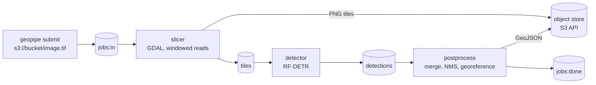

# geo-pipeline

Find objects in large GeoTIFFs. Drop a job on a queue and get back a georeferenced GeoJSON of detections (RF-DETR), without ever loading the raster into memory. Runs locally with Docker Compose and is shaped to grow into a hosted service.



## Quick start

Needs Docker and `make`. The first run builds a ~3 GB detector image (CPU PyTorch and the RF-DETR weights), so expect several minutes.

```bash
make e2e
```

This builds the GDAL base image, starts the stack (Valkey, SeaweedFS, three workers), and runs the end-to-end tests. It leaves a synthetic raster and its detections in `data/out/` (`synth.tif`, `result.geojson`); open both in QGIS to see the boxes sit on the drawn rectangles.

## Usage

Start the stack with `make up`. Put your GeoTIFF in `./data/` (it is mounted at `/data`), then:

```bash
T="docker compose run --rm tools"
$T geopipe upload /data/my.tif s3://imagery/my.tif
JOB=$($T geopipe submit s3://imagery/my.tif --model rfdetr | tail -n 1)
$T geopipe wait $JOB          # prints the job status, exits non-zero on error or timeout
$T geopipe download s3://imagery/tenants/local/results/$JOB.geojson /data/out/$JOB.geojson
```

Check on a job at any point with `$T geopipe status $JOB`. A job ends as `done`, `incomplete` (no progress for `timeout_seconds`, default 300: the GeoJSON is partial and lists `missing_tiles`) or `error` (for example a corrupt raster); `wait` exits 0, 2 or 1 respectively. Stop and delete everything with `make down`.

To see what a job did, write PNG plots (the detections on the input, the tile grid, score/size/class distributions, and stage latency across the jobs you list):

```bash
$T geopipe viz $JOB --out /data/out/viz     # -> ./data/out/viz/<job>/*.png and latency.png
```

**Input:** a GeoTIFF with a CRS. Bands 1-3 are used as RGB, a single band is shown as grey, and 16-bit or float data is stretched to 8-bit once per image (2nd-98th percentile). Tiles that contain only nodata are skipped.

**Output:** a GeoJSON FeatureCollection in EPSG:4326, one polygon per detection with `class_name`, `score` and `pixel_bbox` (the box in the source raster's pixels). The collection records the model and the source CRS.

### Web UI

`make up` also serves a web UI at <http://localhost:8080> (built on [indah](https://github.com/leejianrong/indah)): sign in with an API key (`dev-key-a` in compose), pick a model, upload a GeoTIFF, watch the progress bar, and review the detections drawn over a preview of the raster, with a minimum-score slider, a class filter, a job list and a GeoJSON download. Uploads through the UI are capped at 200 MB; use the API or CLI for larger rasters. See [ADR-0013](docs/adr/0013-web-frontend-on-indah.md).

### HTTP API

`make up` also starts an API on `http://localhost:8000` (interactive docs at `/docs`). Every call needs an `X-API-Key` header; the dev keys in `compose.yaml` are `dev-key-a` (tenant `acme`) and `dev-key-b` (tenant `globex`). Tenants only see their own uploads, jobs and results.

```bash
H="X-API-Key: dev-key-a"
UP=$(curl -s -X POST -H "$H" localhost:8000/uploads)                 # {"key", "upload_url"}
curl -X PUT --data-binary @my.tif "$(echo $UP | jq -r .upload_url)"  # bytes go straight to the store
JOB=$(curl -s -X POST -H "$H" -H 'content-type: application/json' localhost:8000/jobs \
  -d "{\"key\": $(echo $UP | jq .key), \"options\": {\"model\": \"rfdetr\"}}" | jq -r .job_id)
curl -s -H "$H" localhost:8000/jobs/$JOB                              # state and progress
curl -s "$(curl -s -H "$H" localhost:8000/jobs/$JOB/result | jq -r .url)" > result.geojson
```

`GET /jobs` lists the tenant's newest jobs, and `/jobs/{id}/result` also returns a preview image URL and the raster size. `options` takes the same fields as the CLI (below). The keys are placeholders: real authentication, per-tenant quotas and a durable job list come with the hosted service. Presigned URLs are signed for `S3_PUBLIC_ENDPOINT` (`http://localhost:8333` in compose), which must be the address clients reach the store on.

## Configuration

Per-job options, passed to `geopipe submit`:

| Option | Default | Meaning |
|---|---|---|
| `--model` | `stub` | `rfdetr` (RF-DETR Small), `yolox` (YOLOX-s through ONNX Runtime), or `stub`, a test backend that boxes bright pixels |
| `--tile-size` | 640 | Tile edge in pixels |
| `--overlap` | 0.2 | Fraction of overlap between neighbouring tiles |

On a machine with an NVIDIA GPU and the NVIDIA container runtime, `make up-gpu` runs the detector on it (`DETECTOR_DEVICE=cuda`; it refuses to start without a visible GPU). It is about 2.5x faster for RF-DETR on our test raster, and `make bench-device` measures CPU against GPU on your machine. The GPU image is much larger because of the CUDA libraries. See [ADR-0012](docs/adr/0012-gpu-detector.md).

Publishing: `make publish-model REPO=<user>/yolox-tiny-buildings` stages the fine-tuned YOLOX-tiny models (FP32 and INT8) with a model card for Hugging Face under CC BY-SA 4.0 (add `UPLOAD=1` and `HF_TOKEN` to upload). Only models that pass the ADR-0014 bar are accepted.

Torch-free image: `make up-slim` runs the detector without torch (ONNX Runtime only; 1.05 GB instead of 4 GB, models load in 0.4 s instead of 6 s) with the same model names, the same detections and the same speed. Fine-tuned RF-DETR weights need `make export-rfdetr RUN=rfdetr-spacenet VARIANT=Small` first. See [ADR-0014](docs/adr/0014-lightweight-cpu-detector.md).

CPU throughput: the detector uses `DETECTOR_THREADS` threads per worker (default 4; more was not faster on a 20-thread CPU), and `docker compose up -d --scale detector=2` runs replicas that share the tile stream. With a stub model on real imagery the pipeline went from 13.5 to 33.5 tiles/s with one detector and 48 with two, after the slicer started writing uncompressed PNG tiles and overlapping encode and upload ([ADR-0014](docs/adr/0014-lightweight-cpu-detector.md)). Do not scale the CPU and GPU detectors together.

Lightweight models for CPU use: `yolox-tiny` (ONNX Runtime, 416 px input) and `rfdetr-nano` are enabled by default beside `rfdetr` (the default choice) and `yolox`. Fine-tuned on SpaceNet buildings and run on 4 CPU threads, `yolox-tiny-buildings` reaches 0.56 mAP@.5 (0.56 as INT8 too, via `make quantise`, which is 1.5x to 2.4x faster again) against 0.59 for `yolox-buildings` at about a third of the model time, and `rfdetr-nano-buildings` reaches 0.60 against 0.66 for `rfdetr-buildings` in about half. YOLOX-nano was tried and dropped: at 0.47 to 0.51 mAP@.5 it missed the bar. All results of the series are on one page: [`docs/benchmarks/lightweight-detector.md`](docs/benchmarks/lightweight-detector.md). Details in [the SpaceNet report](docs/benchmarks/spacenet-khartoum.md) and [ADR-0014](docs/adr/0014-lightweight-cpu-detector.md).

Duplicates across overlapping tiles are removed by class-wise NMS. An object larger than the overlap zone can still be split. Boxes only (no oriented boxes or segmentation).

## Benchmark

`make bench-coco` runs 200 COCO val2017 images through the real pipeline with both detectors and writes a report and plots to `data/out/bench/`: mAP@[.5:.95], mAP@.5, precision, recall, F1, and latency per image. It downloads COCO's annotations once (241 MB, `make coco-data`) and the 200 images (about 30 MB), and keeps them out of git because COCO's image licences include non-commercial terms. COCO shows everyday objects, so the scores do not predict performance on overhead imagery; overhead imagery is covered by a SpaceNet benchmark below.

### SpaceNet buildings (fine-tuned)

`make spacenet-data` fetches 300 SpaceNet 2 Khartoum tiles (730 MB, CC BY-SA 4.0, kept out of git), `make train-rfdetr` and `make train-yolox` (`VARIANT=` picks the model size) fine-tune on 240 of them on the GPU (about 7 and 12 minutes), and `make bench-spacenet` scores the other 30 through the full pipeline. The COCO weights score 0 here because they have no building class.

| model | mAP@[.5:.95] | mAP@.5 | F1@.5 | detector s/image (CPU, 4 threads) |
|---|---|---|---|---|
| RF-DETR Small, fine-tuned | 0.327 | 0.659 | 0.642 | 0.85 |
| RF-DETR Nano, fine-tuned | 0.294 | 0.596 | 0.602 | 0.47 |
| YOLOX-s, fine-tuned | 0.303 | 0.586 | 0.612 | 0.31 |
| YOLOX-tiny 416, fine-tuned | 0.270 | 0.564 | 0.562 | 0.09 |
| YOLOX-tiny 416, INT8 | 0.262 | 0.559 | 0.548 | 0.06 |
| YOLOX-s, INT8 | 0.293 | 0.573 | 0.588 | 0.12 |

Each 650 px image is cut into 4 overlapping 640 px tiles, so per tile the detector takes about a quarter of the last column. One city and one run per model; details and caveats in [`docs/benchmarks/spacenet-khartoum.md`](docs/benchmarks/spacenet-khartoum.md) and [ADR-0010](docs/adr/0010-spacenet-benchmark-dataset.md). Enable the models with `DETECTOR_MODELS=stub,rfdetr,yolox,rfdetr-buildings,yolox-buildings,rfdetr-nano-buildings,yolox-tiny-buildings,yolox-buildings-int8,yolox-tiny-buildings-int8`.

## GDAL + Python + numpy 2 base images

The workers build on `geo-gdal`: GDAL 3.11, 3.12 or 3.13 with Python 3.12 or 3.13 and numpy 2.x, which you can use on its own. The official `ghcr.io/osgeo/gdal` Ubuntu images cannot do this (their 3.11/3.12 bindings break with numpy 2 and there is no Python 3.13), so we build GDAL from source. Details and test results: [ADR-0007](docs/adr/0007-own-gdal-base-image-matrix.md).

```bash
docker run --rm ghcr.io/leejianrong/geo-gdal:gdal3.12-py3.12   # python 3.12.x numpy 2.x gdal 3.12.x OK
docker run --rm ghcr.io/leejianrong/geo-gdal:gdal3.13-py3.13
```

Tags (amd64): `gdal<minor>-py<python>` for each combination, `py3.12` and `py3.13` for the default GDAL (3.12), and immutable `py<python>-gdal<full>-numpy<numpy>` such as `py3.12-gdal3.12.4-numpy2.5.4`. The versions are listed in [`base/matrix.json`](base/matrix.json). The default command checks array round trips for six dtypes, `OpenArray` memory sharing, `/vsis3/` and the GTiff, COG and PNG drivers. Common drivers (including NetCDF, HDF5 and PostgreSQL) are enabled; HDF4, FITS, HEIF and a few others are not.

Build locally: `make base` (default GDAL, both Pythons) or `make base-all` (every combination, about 25 minutes).

## Status and roadmap

Slices V1-V8 are done: the pipeline, RF-DETR and YOLOX, large rasters, plots, failure handling (retries, dead letters, stall timeouts), a COCO benchmark, an HTTP API and a GPU detector. Remaining ideas are durable job records (Postgres), real sign-in, and direct browser uploads; see a SpaceNet benchmark with fine-tuned weights. See [`docs/SLICES.md`](docs/SLICES.md) for the build order, [`docs/PLAN.md`](docs/PLAN.md) for the plan and [`docs/adr/`](docs/adr) for the decisions.

## Contributing

See [`CONTRIBUTING.md`](CONTRIBUTING.md).

## License

Apache-2.0. The stack avoids AGPL components on purpose ([ADR-0009](docs/adr/0009-no-agpl-object-store-seaweedfs.md)).
