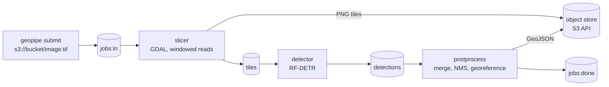

# geo-pipeline

Find objects in large GeoTIFFs. Drop a job on a queue and get back a georeferenced GeoJSON of detections (RF-DETR), without ever loading the raster into memory. Runs locally with Docker Compose and is shaped to grow into a hosted service.



## Quick start

Needs Docker and `make`. The first run builds a ~3 GB detector image (CPU PyTorch and the RF-DETR weights), so expect several minutes.

```bash
make e2e
```

This builds the GDAL base image, starts the stack (Valkey, SeaweedFS, three workers), and runs the end-to-end tests. It leaves a synthetic raster and its detections in `data/out/` (`synth.tif`, `result.geojson`); open both in QGIS to see the boxes sit on the drawn rectangles.

## Usage

Start the stack with `make up`. Put your GeoTIFF in `./data/` (it is mounted at `/data`), then:

```bash
T="docker compose run --rm tools"
$T geopipe upload /data/my.tif s3://imagery/my.tif
JOB=$($T geopipe submit s3://imagery/my.tif --model rfdetr | tail -n 1)
$T geopipe wait $JOB          # prints the job status, exits non-zero on error or timeout
$T geopipe download s3://imagery/tenants/local/results/$JOB.geojson /data/out/$JOB.geojson
```

Check on a job at any point with `$T geopipe status $JOB`. A job ends as `done`, `incomplete` (no progress for `timeout_seconds`, default 300: the GeoJSON is partial and lists `missing_tiles`) or `error` (for example a corrupt raster); `wait` exits 0, 2 or 1 respectively. Stop and delete everything with `make down`.

To see what a job did, write PNG plots (the detections on the input, the tile grid, score/size/class distributions, and stage latency across the jobs you list):

```bash
$T geopipe viz $JOB --out /data/out/viz     # -> ./data/out/viz/<job>/*.png and latency.png
```

**Input:** a GeoTIFF with a CRS. Bands 1-3 are used as RGB, a single band is shown as grey, and 16-bit or float data is stretched to 8-bit once per image (2nd-98th percentile). Tiles that contain only nodata are skipped.

**Output:** a GeoJSON FeatureCollection in EPSG:4326, one polygon per detection with `class_name`, `score` and `pixel_bbox` (the box in the source raster's pixels). The collection records the model and the source CRS.

## Configuration

Per-job options, passed to `geopipe submit`:

| Option | Default | Meaning |
|---|---|---|
| `--model` | `stub` | `rfdetr` for RF-DETR Small, `stub` for a test backend that boxes bright pixels |
| `--tile-size` | 640 | Tile edge in pixels |
| `--overlap` | 0.2 | Fraction of overlap between neighbouring tiles |

Duplicates across overlapping tiles are removed by class-wise NMS. An object larger than the overlap zone can still be split. Boxes only (no oriented boxes or segmentation), CPU inference only.

## GDAL + Python + numpy 2 base images

The workers build on `geo-gdal`: GDAL 3.11, 3.12 or 3.13 with Python 3.12 or 3.13 and numpy 2.x, which you can use on its own. The official `ghcr.io/osgeo/gdal` Ubuntu images cannot do this (their 3.11/3.12 bindings break with numpy 2 and there is no Python 3.13), so we build GDAL from source. Details and test results: [ADR-0007](docs/adr/0007-own-gdal-base-image-matrix.md).

```bash
docker run --rm ghcr.io/leejianrong/geo-gdal:gdal3.12-py3.12   # python 3.12.x numpy 2.x gdal 3.12.x OK
docker run --rm ghcr.io/leejianrong/geo-gdal:gdal3.13-py3.13
```

Tags (amd64): `gdal<minor>-py<python>` for each combination, `py3.12` and `py3.13` for the default GDAL (3.12), and immutable `py<python>-gdal<full>-numpy<numpy>` such as `py3.12-gdal3.12.4-numpy2.5.4`. The versions are listed in [`base/matrix.json`](base/matrix.json). The default command checks array round trips for six dtypes, `OpenArray` memory sharing, `/vsis3/` and the GTiff, COG and PNG drivers. Common drivers (including NetCDF, HDF5 and PostgreSQL) are enabled; HDF4, FITS, HEIF and a few others are not.

Build locally: `make base` (default GDAL, both Pythons) or `make base-all` (every combination, about 25 minutes).

## Status and roadmap

Slices V1-V4 are done: the pipeline, RF-DETR, large rasters, plots, and failure handling (retries, dead letters, stall timeouts). Next are a YOLOX and SpaceNet benchmark, then an HTTP API and web frontend. See [`docs/SLICES.md`](docs/SLICES.md) for the build order, [`docs/PLAN.md`](docs/PLAN.md) for the plan and [`docs/adr/`](docs/adr) for the decisions.

## Contributing

See [`CONTRIBUTING.md`](CONTRIBUTING.md).

## License

Apache-2.0. The stack avoids AGPL components on purpose ([ADR-0009](docs/adr/0009-no-agpl-object-store-seaweedfs.md)).
