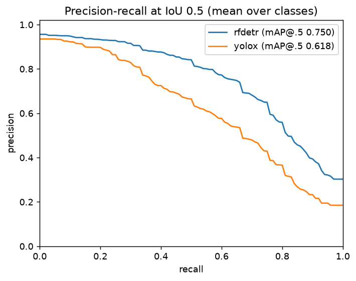
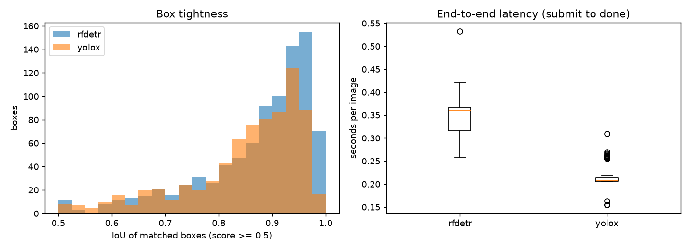

# COCO val2017, 200 images: RF-DETR Small vs YOLOX-s

Run on 2026-11-14 with `make bench-coco` on a laptop (i9-12900H, CPU inference only, no GPU), through the
full pipeline: GeoTIFF upload, S3, queue, slicer, detector, postprocess. Each image is one 640-pixel tile,
so seam handling is not exercised. The images are the 200 lowest-id val2017 images that have at least one
non-crowd annotation. COCO images are not stored in this repository (see ADR-0010).

| model | mAP@[.5:.95] | mAP@.5 | AR@100 | P@.5 | R@.5 | F1@.5 | median latency s/img | mean detect s/img | detections |
|---|---|---|---|---|---|---|---|---|---|
| RF-DETR Small | 0.566 | 0.750 | 0.697 | 0.877 | 0.615 | 0.723 | 0.36 | 0.21 | 15764 |
| YOLOX-s | 0.440 | 0.618 | 0.546 | 0.822 | 0.524 | 0.640 | 0.21 | 0.08 | 3671 |

## Reading it

- RF-DETR is more accurate on every metric here (about +0.13 mAP@[.5:.95]); YOLOX-s is about 1.7x
  faster per image end to end (0.21 s vs 0.36 s) and 2.6x faster in the model itself.
- RF-DETR's boxes are tighter: more matched boxes above 0.95 IoU.
- Detections were collected at confidence >= 0.05, which mAP needs. RF-DETR returns far more
  low-confidence candidates (about 79 per image against 18), which is why its detection count is higher.
  P, R and F1 use only detections with score >= 0.5.
- Latency is client-observed from submit to done, one image at a time. It includes the pipeline
  overhead around the model (about 0.1-0.15 s for S3, queue and the two other stages).

## Caveats

- Two hundred images is a small sample, so differences of a few points are within noise. For context,
  the published full-val2017 figures for these models are lower for YOLOX-s (about 40.5 mAP) and
  RF-DETR Small (about 53); the values quoted here are from memory and were not re-checked, and this subset
  may simply be easier. The agreement is in the right range, which is evidence the pipeline (wrapping as
  GeoTIFF, tiling, NMS, georeferencing) is not distorting boxes, but it is not a proof.
- COCO shows everyday objects. These numbers say nothing about overhead imagery; that needs the
  SpaceNet benchmark and fine-tuned weights (V5b).
- Both models went through the same pipeline settings (NMS IoU 0.65, confidence 0.05). YOLOX applies its
  own NMS at 0.65 as well. RF-DETR needs no NMS, so the pipeline's NMS is an extra step for it.
