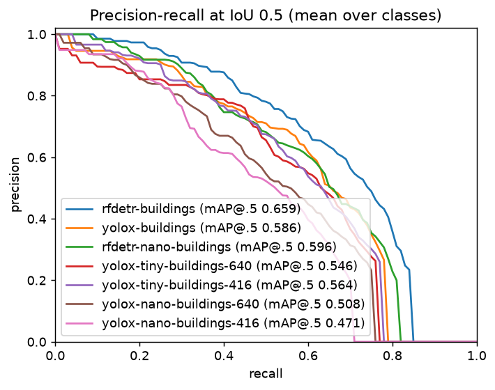
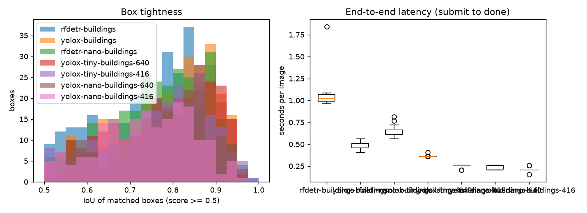

# SpaceNet Khartoum buildings: fine-tuned RF-DETR, YOLOX and their lightweight variants

Held-out 30 tiles, 510 buildings, CPU detector, one worker, run 2026-11-14 (L3, ADR-0014). "detect s/img" is the model's time for one 650 px image, which is 4 tiles.

| model | mAP@[.5:.95] | mAP@.5 | AR@100 | P@.5 | R@.5 | F1@.5 | detect s/img, 4 threads | detect s/img, 1 thread | detections |
|---|---|---|---|---|---|---|---|---|---|
| rfdetr-buildings (Small) | 0.327 | 0.659 | 0.485 | 0.627 | 0.657 | 0.642 | 0.85 | 2.47 | 7795 |
| rfdetr-nano-buildings | 0.294 | 0.596 | 0.452 | 0.624 | 0.582 | 0.602 | 0.47 | 1.31 | 8955 |
| yolox-buildings (s, 640) | 0.303 | 0.586 | 0.467 | 0.689 | 0.551 | 0.612 | 0.31 | 0.94 | 1922 |
| yolox-tiny-buildings-640 | 0.280 | 0.546 | 0.449 | 0.632 | 0.512 | 0.566 | 0.19 | 0.58 | 1818 |
| yolox-tiny-buildings-416 | 0.270 | 0.564 | 0.436 | 0.712 | 0.465 | 0.562 | 0.10 | 0.25 | 2006 |
| yolox-nano-buildings-640 | 0.247 | 0.508 | 0.426 | 0.667 | 0.412 | 0.509 | 0.07 | 0.15 | 2100 |
| yolox-nano-buildings-416 | 0.209 | 0.471 | 0.370 | 0.622 | 0.375 | 0.468 | 0.05 | 0.08 | 2880 |

The model names are those of the benchmark run; only `yolox-tiny-buildings` (the 416 variant) and `rfdetr-nano-buildings` are kept as backends, see "Verdict".

## Verdict (ADR-0014 bar: at least 90% of YOLOX-s's mAP@.5, so 0.527 or more, and at least 2x faster)

- YOLOX-tiny at 416 px passes: 0.564 mAP@.5 and 3.1x (4 threads) to 3.8x (1 thread) faster than YOLOX-s. Kept as `yolox-tiny-buildings`.
- YOLOX-tiny at 640 px has 0.546 but is only 1.6x faster. Dropped; at 416 px it is both faster and has the higher mAP@.5 (it is lower on mAP@[.5:.95], 0.270 against 0.280).
- YOLOX-nano misses on accuracy at both sizes (0.508 and 0.471; recall 0.41 and 0.38). Dropped, along with its COCO backend.
- RF-DETR Nano passes on accuracy (0.596, above YOLOX-s's 0.586) but is slower than YOLOX-s (0.47 against 0.31 s/img), so it fails the speed half of a bar written against YOLOX-s. It is 1.8x faster than RF-DETR Small at 90% of its mAP@.5 and is kept for now as the quality-leaning small model; whether it stays is an open decision.
- End to end through the whole pipeline (one detector, 4 threads, 48-tile mosaic, so including the slicer and postprocess): YOLOX-s 10.1 tiles/s, YOLOX-tiny 416 18.6, RF-DETR Nano 7.1, RF-DETR Small 3.4.

- Detections were collected at confidence >= 0.05 (needed for mAP). P, R and F1 use detections
  with score >= 0.5 and IoU >= 0.5.
- Latency is client-observed, from submit to done, through the whole pipeline (S3, queue, slicer,
  detector, postprocess), one image at a time. "detect" is the model's own time.
- One city (Khartoum); the models were fine-tuned on 240 tiles of the same city, so this does not show generalisation to other places.

## How this was produced

- Data: 300 tiles of SpaceNet 2 AOI 5 (Khartoum), 650x650 16-bit PS-RGB, split by tile number into 240 train, 30 valid and 30 test (`make spacenet-data`). Test is the 30 held-out tiles scored above, 510 buildings.
- RF-DETR Nano: `make train-rfdetr VARIANT=Nano`, same settings as Small. YOLOX-tiny and -nano: `make train-yolox VARIANT=tiny|nano SIZE=416|640`, same recipe as YOLOX-s with the augmentation of the official tiny and nano experiments (mosaic scale 0.5 to 1.5, no mixup), 60 epochs, about 9 to 12 minutes each. The nano variant is no longer supported by the scripts.
- RF-DETR Small: `make train-rfdetr`, from the COCO checkpoint, single class `building`, 30 epochs, batch size 8, about 7 minutes on the RTX 3080 Ti Laptop. Best validation mAP (EMA weights) 0.242.
- YOLOX-s: `make train-yolox`, YOLOX's own trainer from the COCO checkpoint, one class, 60 epochs (last 10 without mosaic), batch size 16, fp16, about 12 minutes. Validation AP@[.5:.95] about 0.24 at the end. Exported to ONNX (raw head, 1 class) and run by the same ONNX Runtime backend as the COCO model.
- Scoring: `make bench-spacenet` runs the held-out GeoTIFFs through the whole pipeline (CPU detector, one image at a time) and scores the GeoJSON pixel boxes against boxes converted from the footprints. Both models see identical inputs.
- The validation numbers are on the 30 valid tiles; the table is on the 30 test tiles, so they are not comparable.

## Reading the numbers

- Before fine-tuning the COCO weights have no `building` class, so the score was 0 by construction; the fine-tune is what makes either model useful here.
- RF-DETR is ahead on mAP and recall (0.327 vs 0.303 mAP@[.5:.95]; recall 0.66 vs 0.55 at IoU 0.5). YOLOX is more precise at the 0.5 score cut (0.69 vs 0.63) and about 2.7x faster in the detector (0.31 s vs 0.85 s per 650 px image on CPU; each image is 4 overlapping 640 px tiles, so about 0.08 s vs 0.21 s per tile), which is the same trade as on COCO. YOLOX also emits far fewer low-score boxes (1922 vs 7794 at confidence 0.05), so its precision-recall curve ends earlier.
- Footprints are converted to axis-aligned boxes, which overstates the area of rotated buildings, and many Khartoum buildings are small, touching or nested. That caps IoU, and mAP@[.5:.95] is the harder number.
- One city, one training run per model, 30 test tiles: the differences between models are small enough that a different split or seed could change the order of some metrics. The numbers show that the pipeline and the fine-tunes work on overhead imagery, not how well they generalise to other cities or sensors.
- The tiles are CC BY-SA 4.0 and are not in the repo; only these metrics and plots are.
